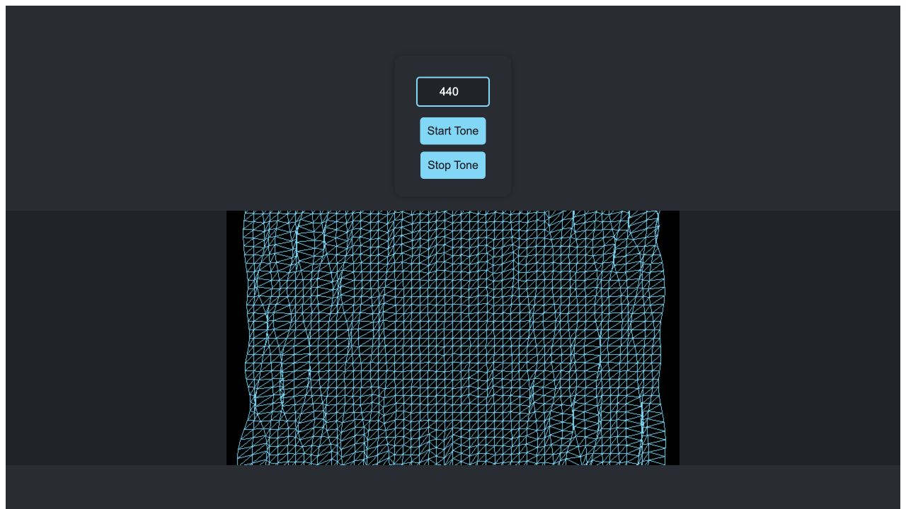

# Waves

A browser-based sine-wave tone generator with an animated 3D wireframe visualization. Built with Next.js, React, the Web Audio API, and Three.js.

[Try the live demo](https://waves-beige-nine.vercel.app/) · [Ask a question](https://github.com/ezam0000/waves/discussions/categories/q-a) · [Report a bug](https://github.com/ezam0000/waves/issues)



## Try it

1. Open the [live demo](https://waves-beige-nine.vercel.app/) in a browser with Web Audio and WebGL support.
2. Set your system volume low, then enter a frequency in hertz. The default is **440 Hz**.
3. Click **Start Tone** to play a sine wave.
4. Change the frequency while the tone is playing to update the sound and visualization.
5. Click **Stop Tone** to stop the sound.

Audio starts after a button click. If you do not hear it, check that the tab and your output device are not muted. The wireframe is a procedural visual effect driven by the frequency value, not a measured audio waveform.

## Run locally

Install Node.js and npm, then clone the repository and install its dependencies:

```sh
git clone https://github.com/ezam0000/waves.git
cd waves
npm install
npm run dev
```

Open [http://localhost:3000](http://localhost:3000). The home page is `src/pages/index.js`.

To build and run the production version locally:

```sh
npm run build
npm start
```

## How it works

| File | Purpose |
| --- | --- |
| [`src/pages/index.js`](src/pages/index.js) | Connects the tone controls and visualization through shared frequency state. |
| [`src/components/ToneGenerator.js`](src/components/ToneGenerator.js) | Creates a Web Audio sine-wave oscillator and provides frequency, start, and stop controls. |
| [`src/components/WaveVisualizer.js`](src/components/WaveVisualizer.js) | Animates a Three.js wireframe plane using the frequency value and simplex noise. |

The interface uses styled-components. The demo is hosted on Vercel.

## Questions and contributions

Use [Q&A Discussions](https://github.com/ezam0000/waves/discussions/categories/q-a) for setup and usage questions. If a reply solves your question, mark it as the answer so others can find it.

For bugs, [open an issue](https://github.com/ezam0000/waves/issues) with your browser, the steps to reproduce the problem, and what you expected to happen. Focused pull requests are welcome.

If you find Waves useful, a star helps other people discover the project.
